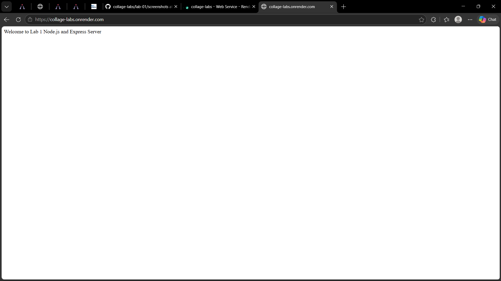
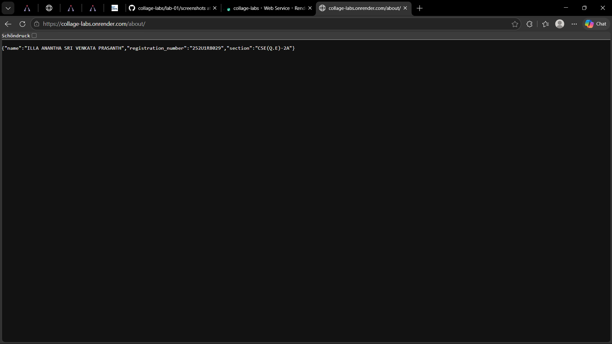
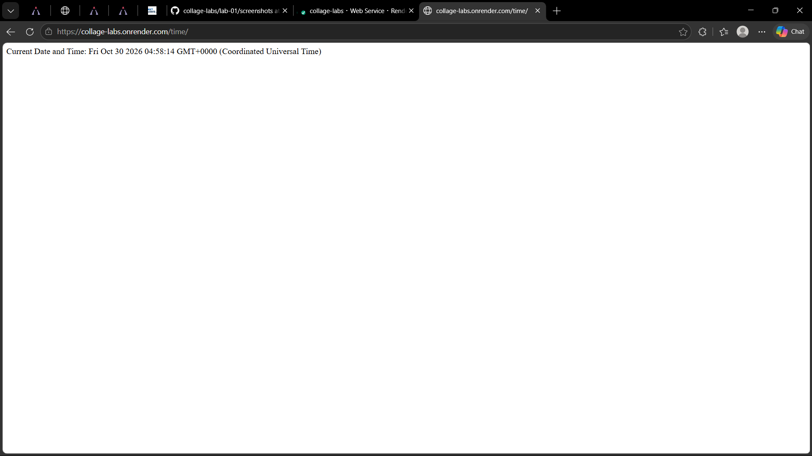
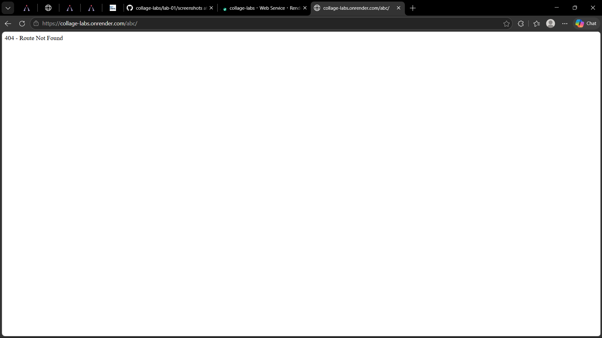

# Lab 1: Node.js and Express server

## Student Details

```text
Name: ILLA ANANTHA SRI VENKATA PRASANTH
Registration Number: 252U1R8029
Section: CSE(Q.E)-2A
```

## Live Link

https://collage-labs.onrender.com

## How to Run

1. Open a terminal inside the `lab-01` folder:
   ```bash
   cd lab-01
   ```

2. Install the required dependencies:
   ```bash
   npm install
   ```

3. Start the Express server:
   ```bash
   node server.js
   ```
   *(Alternatively, you can run `npm start`)*

4. To run the plain Node.js HTTP server instead (make sure `server.js` is stopped first so port `3000` is free):
   ```bash
   node server-http.js
   ```

## Package.json Fields Explained

- **`name`**: The name of the Node.js project (`lab-01`).
- **`version`**: Current version of the project (`1.0.0`).
- **`description`**: A brief summary of what the project does.
- **`main`**: The entry point file of the application (`server.js`).
- **`scripts`**: Custom terminal commands that can be executed with `npm run <script>` or `npm start`.
- **`keywords`**: Array of keywords related to the project.
- **`author`**: Creator of the project.
- **`license`**: Software license for the project (`ISC`).
- **`type`**: Defines the module system used (`commonjs` uses `require()`).
- **`dependencies`**: External packages required for the application to run in production (`express`).

## Endpoints

| Method | Path | Description |
|---|---|---|
| GET | `/` | Returns the welcome message |
| GET | `/about` | Returns name and section as JSON |
| GET | `/time` | Returns the current date and time |
| GET | Any unknown path | Returns a 404 response |

## Screenshots









## Notes

No issues faced during implementation. Both the plain Node.js `http` server and the Express server were tested and verified on port `3000` with appropriate HTTP status codes (`200` and `404`).
