# Lab 3: REST API, query parameters, validation, debugging

## Student Details

```text
Name: ILLA ANANTHA SRI VENKATA PRASANTH
Registration Number: 252U1R8029
Section: CSE(Q.E)-2A
```

## Live Link

Not deployed yet

## Project Description

This project implements an advanced RESTful Book Management API built on **Node.js**, **Express**, and **SQLite** (`database/books.db`). Building upon the CRUD architecture introduced in Lab 2, this lab enhances the API with:

- **Search** (partial title matching using SQL `LIKE`).
- **Sorting** (`order_by` with strict allowlist validation and `order` ASC/DESC).
- **Pagination** (`limit` and `offset` with sensible constraints).
- **Price Range Filtering** (`min_price` and `max_price` supported individually and combined).
- **Combined Filters** (all query parameters functioning simultaneously).
- **Strict Input Validation** on `POST /books/` and `PUT /books/:bookId/` returning clean HTTP 400 client errors.
- **Consistent JSON Error Messages** (`{"message": "..."}`).
- **Debugging Documentation** for four common backend issues (`EADDRINUSE`, `MODULE_NOT_FOUND`, `no such table`, and missing `await`).

## Technologies

- **Runtime**: Node.js (v18+ / v22+ / v24+) & npm
- **Web Framework**: Express (`^5.3.0`)
- **Database**: SQLite3 (`^6.0.1`) with `sqlite` (`^5.1.1`) async/await promise wrapper
- **Development Tooling**: Nodemon (`^3.1.14`)
- **API Testing**: Postman Collection v2.1

## Installation and Execution

1. Navigate into the `lab-03` directory:
   ```bash
   cd lab-03
   ```

2. Install dependencies:
   ```bash
   npm install
   ```

3. *(Optional)* Seed or inspect the SQLite database:
   ```bash
   npm run init-db
   npm run inspect-db
   ```

4. Start the server in development mode (with auto-restart via Nodemon):
   ```bash
   npm run dev
   ```

5. Or start the server in production mode:
   ```bash
   npm start
   ```

- **Environment Variables**: No special `.env` is required. The server listens on `http://localhost:3000` by default or adopts `process.env.PORT` when deployed.

## Database

- **File Location**: `lab-03/database/books.db` (resolved securely using `path.join(__dirname, "database", "books.db")`).
- **Schema (`book` table)**:
  ```sql
  CREATE TABLE book (
      id INTEGER PRIMARY KEY,
      title TEXT,
      author TEXT,
      price INTEGER,
      pages INTEGER
  );
  ```
- **Initial Sample Records**: 10 standard computer science/software engineering books seeded from `database/init.sql` using `INSERT OR IGNORE`.

## API Endpoints

| Method | Endpoint | Purpose | Request Body | Status Codes |
|---|---|---|---|---|
| `GET` | `/books/` | Retrieve books with search, sort, pagination, and price filters | None | `200 OK`, `400 Bad Request` |
| `GET` | `/books/:bookId/` | Retrieve a single book by ID | None | `200 OK`, `400 Bad Request`, `404 Not Found` |
| `POST` | `/books/` | Create a new book | JSON (`title`, `author`, `price`, optional `pages`) | `201 Created`, `400 Bad Request` |
| `PUT` | `/books/:bookId/` | Full update of an existing book | JSON (`title`, `author`, `price`, optional `pages`) | `200 OK`, `400 Bad Request`, `404 Not Found` |
| `DELETE` | `/books/:bookId/` | Delete a book by ID | None | `200 OK`, `400 Bad Request`, `404 Not Found` |

## Query Parameters (`GET /books/`)

| Parameter | Purpose | Default | Validation Rules / Allowed Values |
|---|---|---|---|
| `search_q` | Partial title search (`LIKE %search_q%`) | None (no filter) | String |
| `order_by` | Sorting column | `id` | Must be one of: `id`, `title`, `author`, `price`, `pages` (strict allowlist) |
| `order` | Sorting direction | `ASC` | Must be `ASC` or `DESC` |
| `limit` | Number of records to return | `10` | Positive integer (maximum 100) |
| `offset` | Number of records to skip | `0` | Non-negative integer |
| `min_price` | Minimum price filter (`price >= min_price`) | None (no minimum) | Non-negative number |
| `max_price` | Maximum price filter (`price <= max_price`) | None (no maximum) | Non-negative number; cannot be less than `min_price` |

### Combined Filter Example
```text
GET http://localhost:3000/books/?search_q=JavaScript&order_by=price&order=ASC&limit=5&offset=0&min_price=400&max_price=800
```

## Validation and Errors

The API enforces strict data validation and returns uniform JSON responses:

- **Missing/Empty Title**: `{"message": "Title is required"}` (HTTP 400)
- **Missing/Empty Author**: `{"message": "Author is required"}` (HTTP 400)
- **Missing/Non-numeric Price**: `{"message": "Price must be a valid non-negative number"}` (HTTP 400)
- **Invalid Sorting Column**: `{"message": "Invalid order_by column. Allowed columns: id, title, author, price, pages"}` (HTTP 400)
- **Invalid Limit**: `{"message": "limit must be a positive integer"}` (HTTP 400)
- **Record Not Found**: `{"message": "Book not found"}` (HTTP 404)
- **Internal Server Error**: `{"message": "Internal server error"}` (HTTP 500)

## Debugging

See the comprehensive [DEBUGGING.md](./DEBUGGING.md) guide for in-depth analysis, identification commands, and code fixes for the four required backend issues:
1. `EADDRINUSE` (Port already in use)
2. `MODULE_NOT_FOUND` (Wrong import path)
3. `no such table` (Table name mismatch)
4. Missing `await` on asynchronous database calls

## Postman Tests

A ready-to-import Postman collection with 32 automated tests covering all success and validation scenarios is available at:
`lab-03/postman/Lab-03-REST-API.postman_collection.json`

## Screenshots

### 1. Get All Books (`GET /books/`)
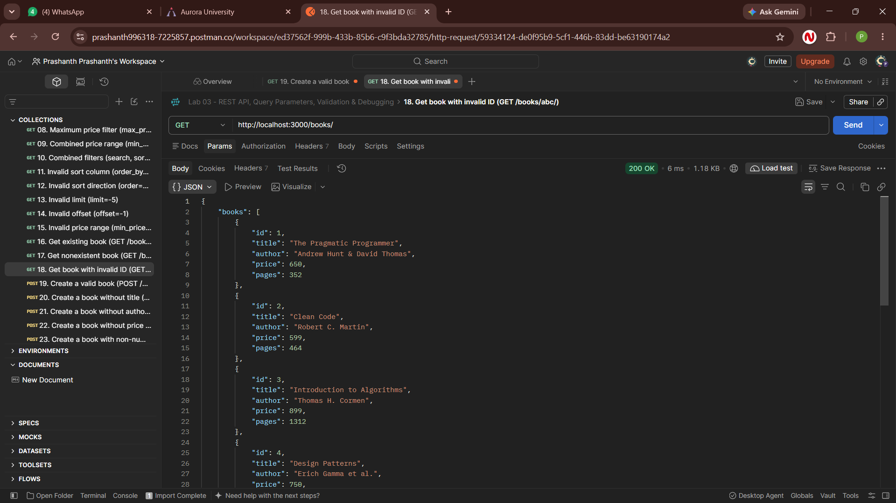

### 2. Search Books by Title (`GET /books/?search_q=JavaScript`)
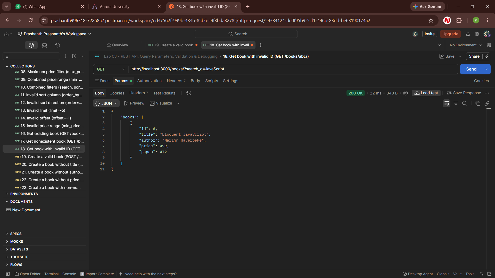

### 3. Sort Books by Price Ascending (`GET /books/?order_by=price&order=ASC`)
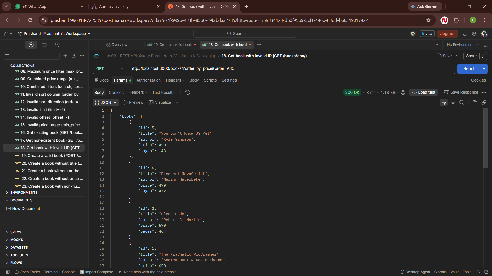

### 4. Pagination (`GET /books/?limit=5&offset=0`)
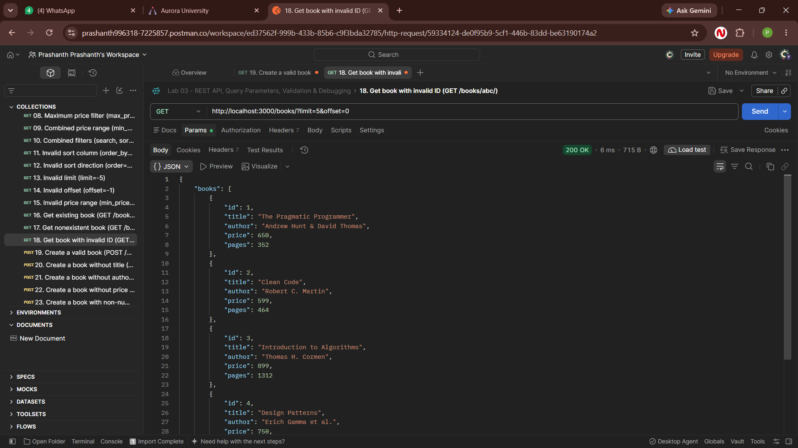

### 5. Price Range Filtering (`GET /books/?min_price=500&max_price=800`)
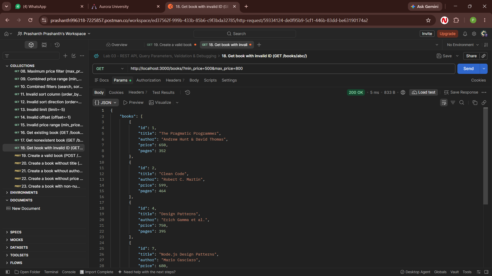

### 6. Combined Query Filters
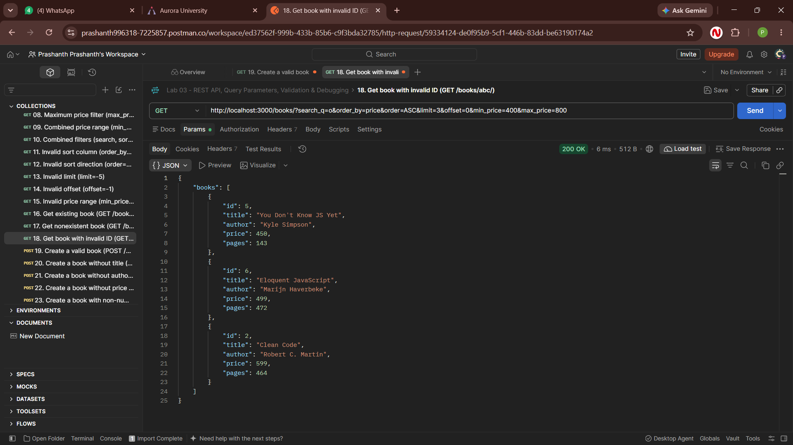

### 7. Get Single Book by ID (`GET /books/1/`)
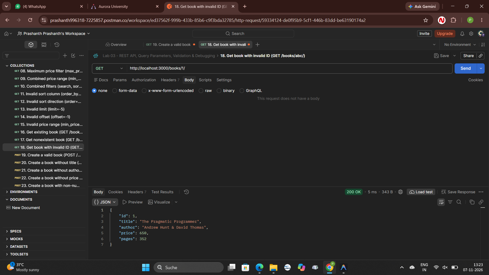

### 8. Create Book Success (`POST /books/`)
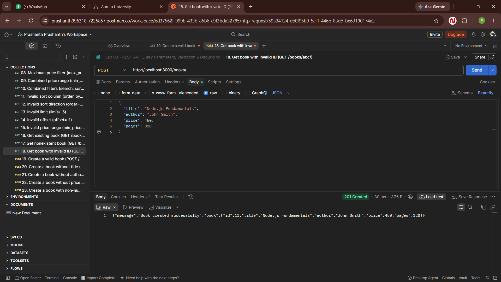

### 9. Create Book Validation Error (`POST /books/` - 400 Bad Request)
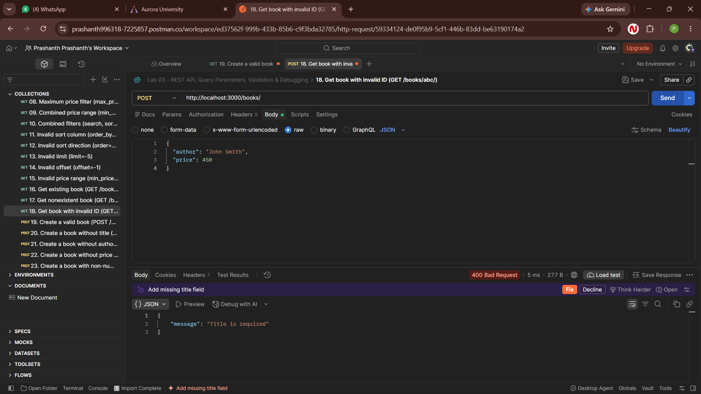

### 10. Update Book Success (`PUT /books/11/`)
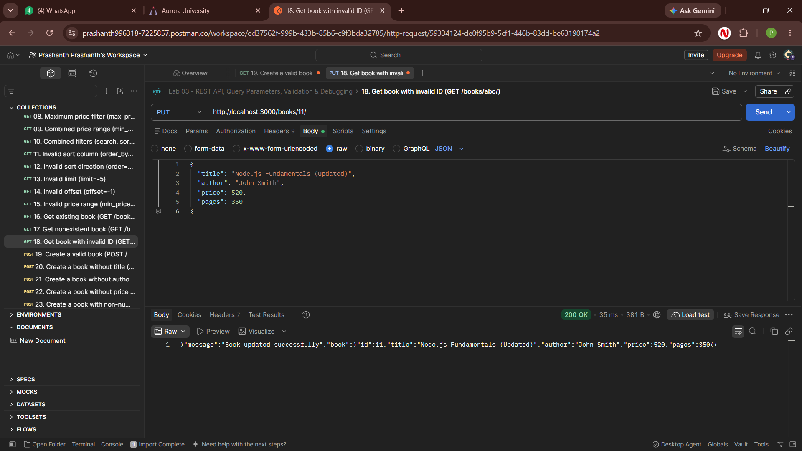

### 11. Delete Book Success (`DELETE /books/11/`)
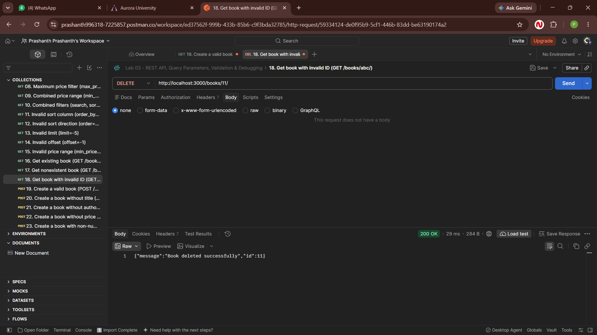

### 12. Nonexistent Book Error (`GET /books/99999/` - 404 Not Found)
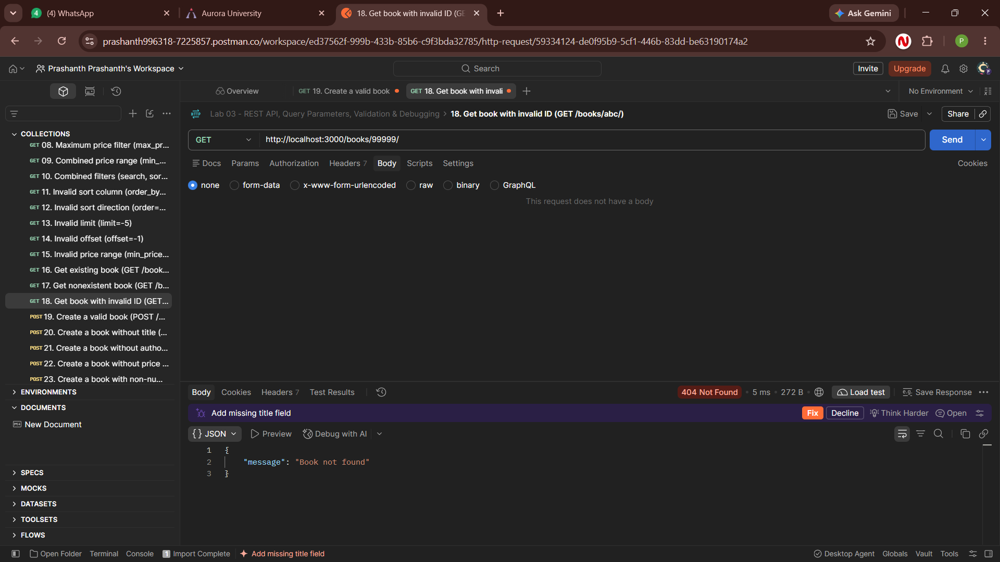

## Notes

No blockers encountered. The Express server connects to `lab-03/database/books.db` independently, and all query parameter combinations, SQL injection protections via allowlisting, and validation error messages were verified with automated tests.
